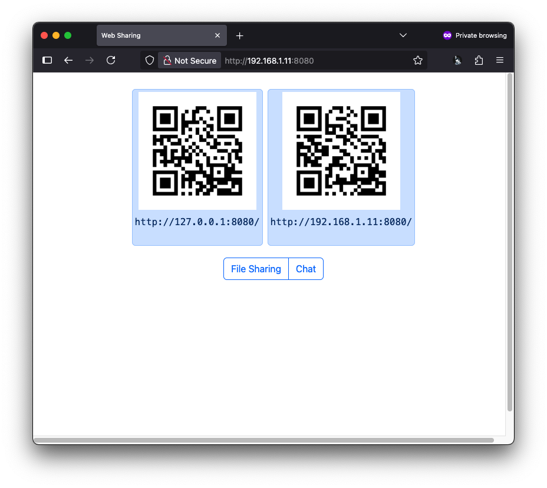
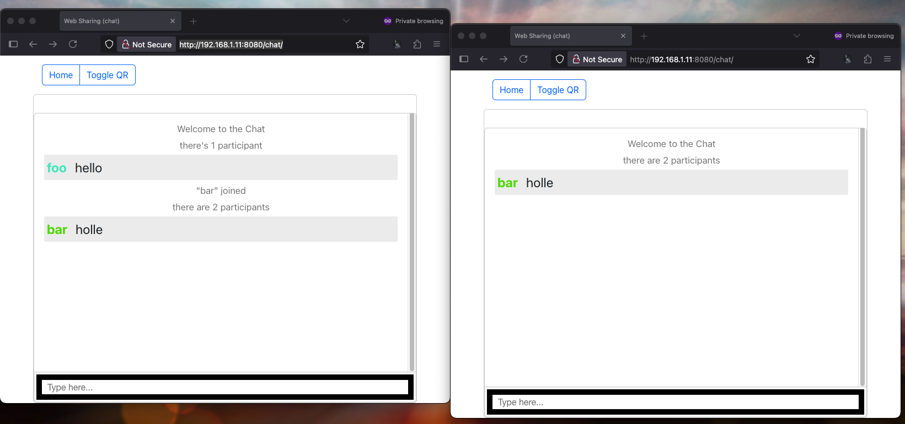
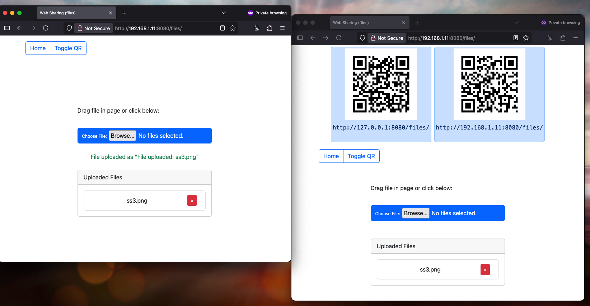

# Web Sharing

[](https://badge.fury.io/js/web-sharing)
[](https://opensource.org/licenses/MIT)
[](https://nodejs.org/)

A lightweight, cross-platform web application for sharing files and chatting over a local network. Perfect for quick file transfers and real-time communication between devices on the same network without requiring external services or internet connectivity.

## ✨ Features

- **📁 File Sharing**: Upload, download, and manage files through an intuitive web interface
- **💬 Real-time Chat**: Instant messaging with live updates using WebSockets
- **📱 Cross-Platform**: Works on any device with a web browser (desktop, mobile, tablet)
- **🔗 QR Code Generation**: Easy connection via QR codes for mobile devices
- **🔍 Auto Port Detection**: Automatically finds and uses available ports
- **🎯 Drag & Drop**: Intuitive file uploading with drag and drop support
- **🌐 Network Discovery**: Displays all available network addresses for easy access
- **🚀 Zero Configuration**: Works out of the box with sensible defaults

## 📸 Screenshots

### Home Dashboard

*QR codes for easy mobile device connection with network addresses*

### Real-time Chat

*Live messaging with user presence and message history*

### File Sharing

*Drag & drop file uploads with real-time file management*

## 🛠 Technologies Used

- **Backend**: Node.js, Express.js
- **Real-time Communication**: Socket.io
- **Frontend**: HTML5, CSS3, JavaScript, Bootstrap 5
- **QR Code Generation**: qr-image, qrcode-terminal
- **CLI**: Commander.js

## 📦 Installation

### Global Installation (Recommended)

```bash
npm install -g web-sharing
```

### Local Development

```bash
git clone https://github.com/raksa/web-sharing.git
cd web-sharing
npm install
```

## 🚀 Usage

### Quick Start

```bash
web-sharing
```

This will:
- Start the server on an automatically detected available port
- Share the current `./share` directory (creates it if it doesn't exist)
- Display QR codes for easy mobile access
- Show all available network URLs

### Command Line Options

```bash
web-sharing [options]

Options:
  -V, --version       output the version number
  -D, --dir <dir>     Target directory to share (default: ./share)
  -P, --port <port>   Port for server to run on (default: auto-detect)
  -h, --help          display help for command
```

### Examples

```bash
# Share a specific directory
web-sharing -D /path/to/your/files

# Use a specific port
web-sharing -P 3000

# Share your Downloads folder on port 8080
web-sharing -D ~/Downloads -P 8080
```

## 🌟 Features Overview

### 🏠 Home Dashboard (`/`)
- QR codes for easy mobile device connection
- Overview of all available network addresses
- Quick navigation to file sharing and chat features

### 📂 File Sharing (`/files/`)
- **Upload**: Drag & drop files or use the file picker
- **Download**: Click on any file to download
- **Delete**: Remove files with confirmation dialog
- **Real-time Updates**: File list updates automatically across all connected devices
- **All File Types**: Support for any file format

### 💭 Chat (`/chat/`)
- **Real-time Messaging**: Instant message delivery using WebSockets
- **User Presence**: See who's online
- **Message History**: Persistent chat history during session
- **Mobile Friendly**: Responsive design for all screen sizes

## 🌐 Network Access

When you start the server, you'll see output similar to this:

```
Starting web-sharing...
Listening on:
-------------------
http://192.168.1.100:3000
 ▄▄▄▄▄▄▄▄▄▄▄▄▄▄▄▄▄▄▄▄▄▄▄▄▄▄▄▄▄▄▄▄▄
 █ ▄▄▄▄▄ █▀█ █▄█▀▀▀█▀▄▄██ ▄▄▄▄▄ █
 █ █   █ █▀▀▀█ ▄▄█▄▀▀  ▄█ █   █ █
 █ █▄▄▄█ █▀ █▀ ▄▀█▄█▄▄██▄ █▄▄▄█ █
-------------------
http://10.0.0.5:3000
 ▄▄▄▄▄▄▄▄▄▄▄▄▄▄▄▄▄▄▄▄▄▄▄▄▄▄▄▄▄▄▄▄▄
```

Use any of these URLs to access the application from other devices on your network, or scan the QR codes with your mobile device.

## 🖥 Browser Support

- **Chrome/Chromium**: 60+
- **Firefox**: 55+
- **Safari**: 11+
- **Microsoft Edge**: 79+
- **Mobile**: iOS Safari, Chrome Mobile, Samsung Internet

## ⚙️ System Requirements

- **Node.js**: 18.0.0 or higher
- **Operating System**: Windows, macOS, Linux
- **Network**: Local network connection
- **Disk Space**: Minimal (< 10MB)

## 🔒 Security Considerations

> ⚠️ **Important**: This application is designed for use on **trusted local networks only**.

- **No Authentication**: Files and chat are accessible to anyone on the network
- **No Encryption**: Data is transmitted in plain text over HTTP
- **Local Network Only**: Not designed for internet-facing deployments
- **File Access**: Anyone with network access can upload, download, and delete files

**Recommended Use Cases:**
- Home networks
- Office/corporate networks with trusted users
- Development environments
- Local file sharing between your own devices

## 📋 FAQ

### Q: Can I use this on the internet?
A: No, this application is designed for local networks only. It lacks security features needed for internet deployment.

### Q: What file types are supported?
A: All file types are supported. The application doesn't process files, it simply serves them.

### Q: How many users can connect simultaneously?
A: There's no hard limit, but performance will depend on your network and system resources.

### Q: Can I customize the interface?
A: Yes, you can modify the files in the `public/` directory to customize the appearance.

## 🚀 Performance Tips

- Use wired connections for large file transfers
- Close unused browser tabs to free up resources
- For many large files, consider using the drag & drop upload feature
- The application works best with modern browsers that support WebSockets

## 🤝 Contributing

Contributions are welcome! Please feel free to submit a Pull Request. For major changes, please open an issue first to discuss what you would like to change.

### Development Setup

```bash
git clone https://github.com/raksa/web-sharing.git
cd web-sharing
npm install
node web-sharing.mjs
```

### Project Structure

```
web-sharing/
├── src/
│   ├── index.mjs        # Main application entry
│   ├── httpApp.mjs      # HTTP server setup
│   ├── fileApp.mjs      # File sharing logic
│   ├── chatApp.mjs      # Chat functionality
│   └── helpers.mjs      # Utility functions
├── public/              # Static web files
│   ├── index.html       # Home page
│   ├── fileApp.html     # File sharing interface
│   ├── chatApp.html     # Chat interface
│   ├── css/            # Stylesheets
│   └── js/             # Client-side JavaScript
└── web-sharing.mjs      # CLI entry point
```

1. Fork the repository
2. Create your feature branch (`git checkout -b feature/AmazingFeature`)
3. Commit your changes (`git commit -m 'Add some AmazingFeature'`)
4. Push to the branch (`git push origin feature/AmazingFeature`)
5. Open a Pull Request

## 📝 Changelog

### v0.0.1 (Current)
- Initial release
- File sharing functionality
- Real-time chat
- QR code generation
- Auto port detection

## 🐛 Issues & Support

If you encounter any issues or have questions:

1. Check the [Issues](https://github.com/raksa/web-sharing/issues) page
2. Create a new issue with detailed information
3. Include your Node.js version and operating system

## 📄 License

This project is licensed under the MIT License - see the [LICENSE](LICENSE) file for details.

## 👨‍💻 Author

**Raksa Eng** - [eng.raksa@gmail.com](mailto:eng.raksa@gmail.com)

---

⭐ If you found this project helpful, please give it a star on GitHub!