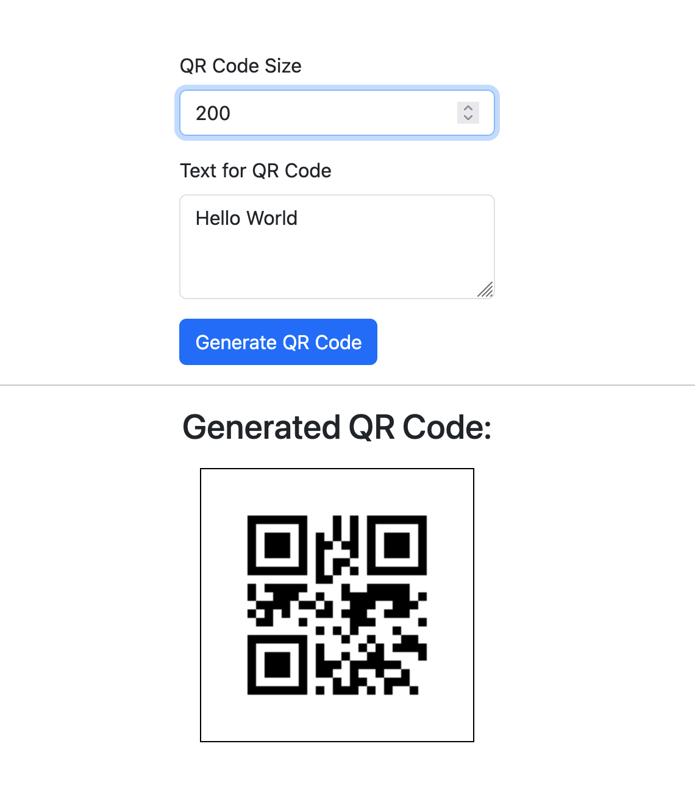

# Local Web Share (lw-share)

[](https://badge.fury.io/js/lw-share)
[](https://opensource.org/licenses/MIT)
[](https://nodejs.org/)

A lightweight, cross-platform web application for sharing files and chatting over a local network. Perfect for quick file transfers and real-time communication between devices on the same network without requiring external services or internet connectivity.

## ✨ Features

- **📁 File Sharing**: Upload, download, and manage files through an intuitive web interface
- **💬 Real-time Chat**: Instant messaging with live updates using WebSockets
- **📱 Cross-Platform**: Works on any device with a web browser (desktop, mobile, tablet)
- **🔗 QR Code Generation**: Easy connection via QR codes for mobile devices
- **🔍 Auto Port Detection**: Automatically finds and uses available ports
- **🎯 Drag & Drop**: Intuitive file uploading with drag and drop support
- **🌐 Network Discovery**: Displays all available network addresses for easy access
- **🚀 Zero Configuration**: Works out of the box with sensible defaults

## 📸 Screenshots

### Home Dashboard

*QR codes for easy mobile device connection with network addresses*

### Real-time Chat

*Live messaging with user presence and message history*

### File Sharing

*Drag & drop file uploads with real-time file management*

### QR Code Generation

*Generate QR codes for easy sharing and access*

## 🛠 Technologies Used

- **Backend**: Node.js, Express.js
- **Real-time Communication**: Socket.io
- **Frontend**: HTML5, CSS3, JavaScript, Bootstrap 5
- **QR Code Generation**: qr-image, qrcode-terminal
- **CLI**: Commander.js

## 📦 Installation

### Usage

```bash
npm install lw-share
```

```javascript
"use strict";

const {
    init: initApp, httpServer, getUrlList, getRandomPort,
} = require('lw-share');

getRandomPort().then((port) => {
    const dir = './share'; // Directory to share

    console.log('Starting lw-share...');
    initApp(dir, port);
    httpServer.on('listening', () => {
        console.log('Listening on:');
        const urls = getUrlList(port);
        urls.forEach((url) => {
            console.log(url);
        });
    });
    httpServer.listen(port);
});

```

ES Module:


```javascript
"use strict";

import {
    init as initApp, httpServer, getUrlList, getRandomPort,
} from 'lw-share';

```

### Global Installation

```bash
npm install -g lw-share
```

### Local Development

```bash
git clone https://github.com/raksa/lw-share.git
cd lw-share
npm install
```

## 🚀 Usage

### Quick Start

```bash
lw-share
```

This will:
- Start the server on an automatically detected available port
- Share the current `./share` directory (creates it if it doesn't exist)
- Display QR codes for easy mobile access
- Show all available network URLs

### Examples

```bash
# Share a specific directory
lw-share -D /path/to/your/files

# Use a specific port
lw-share -P 3000

# Share your Downloads folder on port 8080
lw-share -D ~/Downloads -P 8080
```

## 🌟 Features Overview

### 🏠 Home Dashboard (`/`)
- **Connect your phone**: One QR code for the address most likely to work on your Wi-Fi; loopback, link-local and virtual-machine adapters are listed separately under "Not working? Try another address"
- **Copy link** for every address
- Quick navigation to files, chat and the QR code generator

Every page has the same header with an **Open on another device** button that shows a QR code for the page you are on, and follows your system's light or dark theme.

### 📂 File Sharing (`/files/`)
A Google-Drive-style explorer for the shared folder.
- **Folders**: Breadcrumbs, and every folder has its own URL (`/files/Photos/2024/`), so Back/Forward and shared links work
- **Upload**: New → New folder / New file / File upload / Folder upload, or drag files and whole folders from the desktop onto the page, a folder or a breadcrumb. Pasting a screenshot uploads it
- **Upload panel**: Per-file progress, cancel and retry, three uploads at a time, and a warning before leaving the page mid-upload. No size limit
- **No overwrites**: A name that already exists keeps both files (`photo (1).jpg`)
- **Edit text files**: New → New file asks for a full name (`notes.md`) and opens it in a plain text editor; Edit in the item menu opens existing text files up to 5 MB. Ctrl/Cmd+S saves and keeps editing. Line endings are kept, and saving over someone else's newer version asks first
- **Organize**: Rename (F2), Move to… (folder picker), Delete (Del, with confirmation; permanent, no trash), Download, Copy link. Drag items onto a folder or breadcrumb to move them
- **Select**: Click, Ctrl/Cmd+click, Shift+click, box-drag or Ctrl+A; right-click or ⋮ for the item menu. On touch screens, tap to open and long-press to select
- **Views**: List or grid (with image thumbnails), sort by name, date modified or size, and filter the folder
- **Live**: Changes from other devices appear on their own within a few seconds
- **Without JavaScript**: A basic upload form still posts to the top folder

### 💭 Chat (`/chat/`)
- **Real-time Messaging**: Instant message delivery using WebSockets
- **User Presence**: See how many people are online and who is typing
- **Copy any message** with one tap, even over plain `http://` on a phone
- **Clickable links** and multi-line messages (Enter sends, Shift+Enter adds a line)
- **Remembers your name** on each device; rejoins automatically after a reconnect
- **Not stored**: only people with the chat open receive a message

### QR Code Generation (`/qrCoder/`)
- **Live preview**: The QR code updates as you type text or a URL
- **Sizes**: Small, medium or large PNG
- **Download QR Codes**: Save generated QR codes as PNG images

## 🌐 Network Access

When you start the server, you'll see output similar to this:

```
Starting lw-share...
Listening on:
-------------------
http://192.168.1.100:3000
 ▄▄▄▄▄▄▄▄▄▄▄▄▄▄▄▄▄▄▄▄▄▄▄▄▄▄▄▄▄▄▄▄▄
 █ ▄▄▄▄▄ █▀█ █▄█▀▀▀█▀▄▄██ ▄▄▄▄▄ █
 █ █   █ █▀▀▀█ ▄▄█▄▀▀  ▄█ █   █ █
 █ █▄▄▄█ █▀ █▀ ▄▀█▄█▄▄██▄ █▄▄▄█ █
-------------------
http://10.0.0.5:3000
 ▄▄▄▄▄▄▄▄▄▄▄▄▄▄▄▄▄▄▄▄▄▄▄▄▄▄▄▄▄▄▄▄▄
```

Use any of these URLs to access the application from other devices on your network, or scan the QR codes with your mobile device.

## 🖥 Browser Support

- **Chrome/Chromium**: 60+
- **Firefox**: 55+
- **Safari**: 11+
- **Microsoft Edge**: 79+
- **Mobile**: iOS Safari, Chrome Mobile, Samsung Internet

## ⚙️ System Requirements

- **Node.js**: 18.0.0 or higher
- **Operating System**: Windows, macOS, Linux
- **Network**: Local network connection
- **Disk Space**: Minimal (< 10MB)

## 🔒 Security Considerations

> ⚠️ **Important**: This application is designed for use on **trusted local networks only**.

- **No Authentication**: Files and chat are accessible to anyone on the network
- **No Encryption**: Data is transmitted in plain text over HTTP
- **Local Network Only**: Not designed for internet-facing deployments
- **File Access**: Anyone with network access can upload, download, rename, move and delete files. Deletes are permanent

**Recommended Use Cases:**
- Home networks
- Office/corporate networks with trusted users
- Development environments
- Local file sharing between your own devices

## 📋 FAQ

### Q: Can I use this on the internet?
A: No, this application is designed for local networks only. It lacks security features needed for internet deployment.

### Q: What file types are supported?
A: All file types are supported. The application doesn't process files, it simply serves them.

### Q: How many users can connect simultaneously?
A: There's no hard limit, but performance will depend on your network and system resources.

### Q: Can I customize the interface?
A: Yes, you can modify the files in the `public/` directory to customize the appearance.

## 🚀 Performance Tips

- Use wired connections for large file transfers
- Close unused browser tabs to free up resources
- For many large files, consider using the drag & drop upload feature
- The application works best with modern browsers that support WebSockets

## 🤝 Contributing

Contributions are welcome! Please feel free to submit a Pull Request. For major changes, please open an issue first to discuss what you would like to change.

### Development Setup

```bash
git clone https://github.com/raksa/lw-share.git
cd lw-share
npm install
node lw-share.mjs
```

#### Desktop dev window (Electron + Chrome DevTools MCP)

```bash
npm run dev
```

This starts lw-share on `http://localhost:3006` (restarting when `src/` changes) and opens it in an Electron window that exposes the Chrome remote-debugging port on `127.0.0.1:9226`. Closing the window stops both. The bundled [`.mcp.json`](.mcp.json) (Claude Code) and [`.codex/config.toml`](.codex/config.toml) (Codex) connect [`chrome-devtools-mcp`](https://github.com/ChromeDevTools/chrome-devtools-mcp) to that port, so an AI agent can inspect and drive the running app. See [AGENTS.md](AGENTS.md) for the workflow. Electron is a dev dependency only and is not part of the published package.

### Project Structure

```
lw-share/
├── src/
│   ├── index.mjs        # Main application entry
│   ├── httpApp.mjs      # HTTP server setup, /info routes
│   ├── fileApp.mjs      # File routes and the /api/files JSON API
│   ├── fileStore.mjs    # Filesystem operations, confined to the shared folder
│   ├── chatApp.mjs      # Chat functionality
│   ├── qrCoder.mjs      # QR code generation route
│   └── helpers.mjs      # Utility functions
├── public/              # Static web files
│   ├── index.html       # Home page
│   ├── fileApp.html     # File explorer
│   ├── chatApp.html     # Chat interface
│   ├── qrCoder.html     # QR code generator
│   ├── css/             # Stylesheets (style.css is shared by every page)
│   ├── img/icons.svg    # Icon sprite
│   └── js/              # Client-side JavaScript (common.js is shared by every page)
├── test/                # node --test suites (npm test)
├── scripts/
│   └── electron-dev.mjs # Dev-only Electron window (npm run dev)
└── lw-share.mjs      # CLI entry point
```

### HTTP API

| Route | Purpose |
| --- | --- |
| `GET /api/files/list?path=<folder>` | List a folder |
| `POST /api/files/folder` `{path, name}` | Create a folder |
| `POST /api/files/file` `{path, name}` | Create an empty file |
| `GET /api/files/text?path=<file>` | A UTF-8 text file (up to 5 MB) as `{path, content, size, mtime}` |
| `PUT /api/files/text?path=<file>&mtime=<mtime>` | Replace a file's contents with the raw body; with `mtime`, answers 412 instead if the file changed since it was read |
| `POST /api/files/rename` `{path, name}` | Rename a file or folder |
| `POST /api/files/move` `{paths, destination}` | Move items into a folder |
| `POST /api/files/delete` `{paths}` | Delete items (permanent) |
| `PUT /api/files/upload?path=<folder>&name=<file>` | Upload a raw body; `name` may contain `/` for folder uploads |
| `GET /info/files` | Files in the top folder: `fileList` (names) and `files` (name, size, mtime) |
| `GET /info/addresses?pathname=<path>` | Network addresses with QR codes, adapter name and `internal`/`virtual` flags |
| `POST /qrCoder/` `{text, size}` | Generate a QR code PNG as a data URL |

`/api/files` POSTs require `Content-Type: application/json` (a CSRF guard), and those routes send no CORS headers. The older `POST /files/` (multipart upload) and `DELETE /files/<name>` routes still work.

1. Fork the repository
2. Create your feature branch (`git checkout -b feature/AmazingFeature`)
3. Commit your changes (`git commit -m 'Add some AmazingFeature'`)
4. Push to the branch (`git push origin feature/AmazingFeature`)
5. Open a Pull Request

### Releasing to npm

For maintainers, from a clean `main`:

```bash
npm test
npm pack --dry-run                          # check which files go in the package
npm whoami                                  # run `npm login` if this fails
npm version patch --tag-version-prefix=""   # or minor / major
npm publish
git push origin main --follow-tags
npm view lw-share version                   # confirm the new version is live
```

`npm version` updates `package.json` and `package-lock.json`, commits them and creates the git tag. `--tag-version-prefix=""` keeps tags in this repo's style (`0.0.7`, not `v0.0.7`). Don't bump `package.json` by hand as well, or you will skip a version. See [RELEASE_GUIDE.md](RELEASE_GUIDE.md) for the full checklist, including a test install of the packed tarball.

## 📝 Changelog

### v0.0.1 (Current)
- Initial release
- File sharing functionality
- Real-time chat
- QR code generation
- Auto port detection

## 🐛 Issues & Support

If you encounter any issues or have questions:

1. Check the [Issues](https://github.com/raksa/lw-share/issues) page
2. Create a new issue with detailed information
3. Include your Node.js version and operating system

## 📄 License

This project is licensed under the MIT License - see the [LICENSE](LICENSE) file for details.

## 👨‍💻 Author

**Raksa Eng** - [eng.raksa@gmail.com](mailto:eng.raksa@gmail.com)

---

⭐ If you found this project helpful, please give it a star on GitHub!